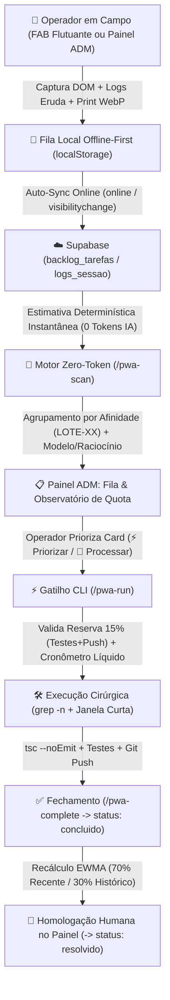

# 🚀 Backlog Agêntico, Telemetria DevTools, Observatório de Quota & Motor Zero-Token (`/pwa`)

O módulo de **Backlog Agêntico & Observatório de Quota** do **PaletScan PWA** integra a captura tátil de demandas em campo (câmaras frigoríficas e chão de loja) diretamente ao ciclo de engenharia autônoma da CLI do **Antigravity** no Termux.

Sua arquitetura foi desenhada sob o princípio **Zero-Token Estimation**: toda a estimativa de tokens, tempo líquido de execução, agrupamento por afinidade de arquivos e auto-calibração matemática ocorre **100% em CPU local via Node.js/TypeScript**, preservando integralmente a quota semanal de LLM para codificação cirúrgica, testes e deploy.

---

## 1. Arquitetura e Fluxo Ponta a Ponta

---

## 2. Captura em Campo e Telemetria DevTools Offline-First

Quando um usuário com a permissão granular **`podeBacklog`** (`Backlog Agêntico`) ativa o botão flutuante ou abre o formulário no Painel ADM (`/admin` ➔ **Backlog & Quota IA**), o coletor [`lib/backlog/devtoolsTelemetryCollector.ts`](https://github.com/NaejBarbosa/paletscan-pwa) captura automaticamente:

- **Contexto Ambiental**: Rota ativa (`pathname`), filial ativa (`410`, `999`, etc.), tema (`dark`/`light`), status de conectividade e dimensões reais do viewport mobile.
- **Inspeção DOM Tátil**: Seletor, XPath simplificado, `boundingClientRect` e estilos computados (`pointer-events`, `overflow-y`, `z-index`, `touch-action`) do último elemento interagido e de qualquer modal/overlay ativo.
- **Buffer de Erros e Console**: Últimas entradas do `clientLogBridge` e pilha de erros recentes capturados pelo Eruda/DevTools.
- **Evidência Visual Compacta**: Compressão automática de print/imagem em Canvas HTML5 (`image/webp`, máximo `800px` de largura, qualidade `0.65`, `< 80 KB`), evitando sobrecarga de payloads.

### Resiliência em Câmara Fria (`backlogOfflineSync.ts`)
- Se o smartphone estiver sem rede no interior da câmara frigorífica, o card é salvo em `0ms` na chave isolada `paletscan_backlog_offline_queue_v1` com status `rascunho_offline` (sem jamais interferir nas chaves de inventário `pending_sync` ou `pending_deletions`).
- Ao recuperar conectividade, o serviço sincroniza automaticamente em background para o Supabase e promove o card para a fila ativa.

---

## 3. Governança de Status e Trava de Homologação Humana

O ciclo de vida de cada tarefa (`BacklogStatus`) obedece a uma segregação estrita de responsabilidades entre o **Agente CLI (`agent_cli`)** e o **Administrador Humano (`human_admin`)**:

| Status | Responsável | Descrição Operacional |
| :--- | :--- | :--- |
| `rascunho_offline` | App Mobile (Offline) | Card registrado sem rede na câmara fria aguardando reconexão. |
| `aberto` | Operador / Admin | Card recém-sincronizado na fila do servidor. |
| `estimado_ia` | Motor Zero-Token | Card analisado matematicamente com arquivos-alvo, tokens e tempo estimados. |
| `priorizado` | Operador / Admin | Card autorizado para processamento imediato na CLI (`/pwa-run`). |
| `em_execucao` | Agente CLI | Card em processamento ativo com Cronômetro Líquido em andamento. |
| `concluido` | **Agente CLI (Teto)** | Código implementado, testado e enviado via push. **Aguarda revisão humana.** |
| `resolvido` | **Exclusivo Humano** | Homologado em produção pelo administrador via botão **✓ Homologar e Marcar Resolvido**. |

> [!IMPORTANT]
> **Trava de Segurança Imutável**: Tanto a API `/api/admin/backlog` quanto `enforceStatusPromotionGuard()` bloqueiam com HTTP `403` qualquer tentativa de um ator `agent_cli` promover uma tarefa diretamente para `resolvido`.

---

## 4. Motor Determinístico Zero-Token e Auto-Calibração EWMA

Localizado em `scripts/pwa_backlog_agent.ts` e `lib/backlog/backlogServerStore.ts`, o motor calcula todas as métricas via CPU local em Node.js:

### 4.1 Resolução Estática de Arquivos-Alvo e Agrupamento em Lote
1. **Mapeamento Determinístico**: Analisa título, descrição, rota ativa e erros recentes para identificar os `arquivos_alvo` (ex: `pages/admin.tsx`, `pages/index.tsx`, `lib/database/sync.ts`, `docs/pwa-backlog-agentico.md`) e cruza com o ranking pré-indexado em `logs/repo_files_metrics.json`.
2. **Afinidade de Lote (`conjunto`)**: Quando 2 ou mais cards abertos/priorizados possuem interseção em `arquivos_alvo`, o motor atribui automaticamente o mesmo `grupo_lote_id` (ex: `LOTE-01`), define `modo_execucao = 'conjunto'` e desconta do orçamento de tokens a leitura duplicada dos arquivos compartilhados.

### 4.2 Árvore de Decisão de Modelo e Raciocínio
- **Baixo (`Flash` / Raciocínio `baixo`)**: Ajustes visuais (`tipo === 'ux'`), espaçamento CSS ou inputs isolados em 1 arquivo.
- **Médio (`3.1 Pro` / Raciocínio `medio`)**: Novas rotas de API, múltiplos componentes ou melhorias funcionais/documentação.
- **Alto (`4 Argon` / Raciocínio `alto`)**: Alterações em `lib/database/sync.ts`, resolução de conflitos WatermelonDB/offline ou tarefas críticas com mais de 3 arquivos-alvo.

### 4.3 Fórmulas de Estimativa, Cronômetro Líquido e EWMA
- **Estimativa de Tokens**:
  $$\text{Tokens}_{\text{est}} = \left(\frac{\text{Bytes}_{\text{cirúrgicos}}}{4} \times F_{\text{tipo}} + \text{Média}_{\text{hist}} + \text{Reserva}_{15\%}\right) \times F_{\text{calib\_tokens}}$$
- **Cronômetro Líquido (`NetExecutionTimer`)**:
  $$\text{Tempo}_{\text{líquido}} = \text{Tempo}_{\text{bruto}} - \text{Tempo}_{\text{interrupção\_rede}}$$
  Desconta automaticamente segundos perdidos com oscilações de rede ou timeouts HTTP no ambiente móvel.
- **Auto-Calibração EWMA (Exponentially Weighted Moving Average)**:
  Ao concluir cada corrida (`/pwa-complete`), os fatores `fator_calibracao_tokens` e `fator_calibracao_tempo` são recalculados atribuindo **70% de peso às últimas 10 execuções** e **30% ao histórico acumulado**.

---

## 5. Comandos de Barra (`/pwa`) no Antigravity CLI

Todas as skills e workflows estão registrados em `.agents/skills/`, `.agents/workflows/` e `~/.gemini/config/skills/`, ficando disponíveis no autocompletar `/` do terminal:

| Comando Slash | Script Equivalente (`npm`) | Função Principal |
| :--- | :--- | :--- |
| `/pwa` | `npm run pwa` | Orquestrador completo: roda `scan`, valida `quota`, executa `run` nos cards priorizados e finaliza com `complete`. |
| `/pwa-backlog` | `npm run pwa:scan && npm run pwa:run` | Atalho dedicado para inspecionar e processar a fila do Backlog Agêntico. |
| `/pwa-scan` | `npm run pwa:scan` | Executa a estimativa determinística Zero-Token em todos os cards abertos/priorizados. |
| `/pwa-run` | `npm run pwa:run` | Valida a reserva obrigatória de 15% (Testes+Push), inicia o Cronômetro Líquido e entrega linhas focais via `grep -n`. |
| `/pwa-complete` | `npx tsx scripts/pwa_backlog_agent.ts complete` | Promove o card/lote para `concluido`, desconta interrupções de rede e recalibra o EWMA. |
| `/pwa-quota` | `npm run pwa:quota` | Exibe no terminal o saldo seguro de tokens, reserva de 15%, fatores EWMA e status dos modelos. |
| `/pwa-devtools` | `npm run devtools:diagnosticar && npm run pwa:scan` | Diagnóstico unificado de logs do Eruda/Supabase + verificação da fila do Backlog. |

---

## 6. Observatório Analítico Bidirecional e Persistência Supabase

No Painel ADM (`/admin` ➔ **Backlog & Quota IA**), o administrador dispõe de três visões integradas:

1. **Header de Quota Semanal (`BacklogQuotaHeader.tsx`)**:
   - Barra segmentada em tempo real exibindo **Tokens Consumidos**, **Reserva Obrigatória de 15% (Testes + Push)** e **Saldo Livre Seguro**.
   - Seletor rápido de disponibilidade dos modelos (**Baixo / Flash**, **Médio / 3.1 Pro**, **Alto / 4 Argon**) entre `Ativo`, `Reserva` e `Esgotado`.
2. **Observatório Analítico (`BacklogTokenAnalytics.tsx`)**:
   - **Gráfico 1**: Evolução do tamanho do repositório (KB/MB e LOC) vs. Queima de Tokens por Commit desde a criação dos repositórios (Julho/2026).
   - **Gráfico 2**: Evolução da Assertividade da IA (Tokens e Tempo Líquido **Estimado vs. Real**).
   - **Ranking de Arquivos**: Lista paginada (`Top 5` ➔ `Ver mais`) ordenada pelo histórico real de modificações.
   - **Filtro Cruzado Bidirecional**: Toque em um ponto do gráfico filtra os arquivos daquele commit; toque em um arquivo na lista destaca na curva apenas os commits que o modificaram.
3. **Persistência Direta no Supabase (`backlogServerStore.ts`)**:
   - Todas as tarefas, configurações de quota, série histórica minerada (`860+` commits) e métricas de arquivos são sincronizados diretamente no Supabase (`logs_sessao` com chaves `PALETSCAN_BACKLOG_*` e tabelas dedicadas), garantindo disponibilidade imediata em deploys serverless (Vercel) e múltiplos dispositivos.
